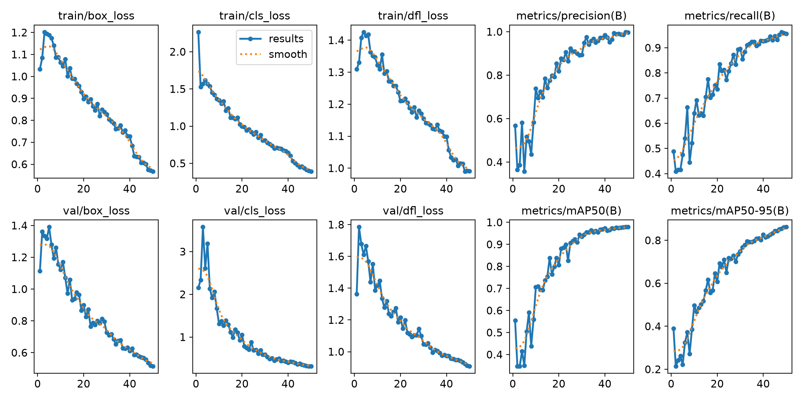
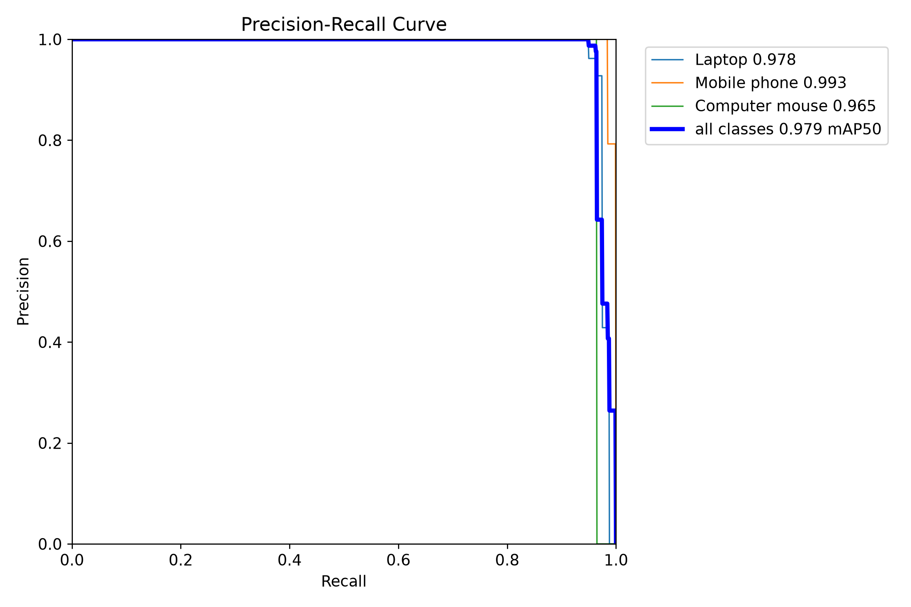
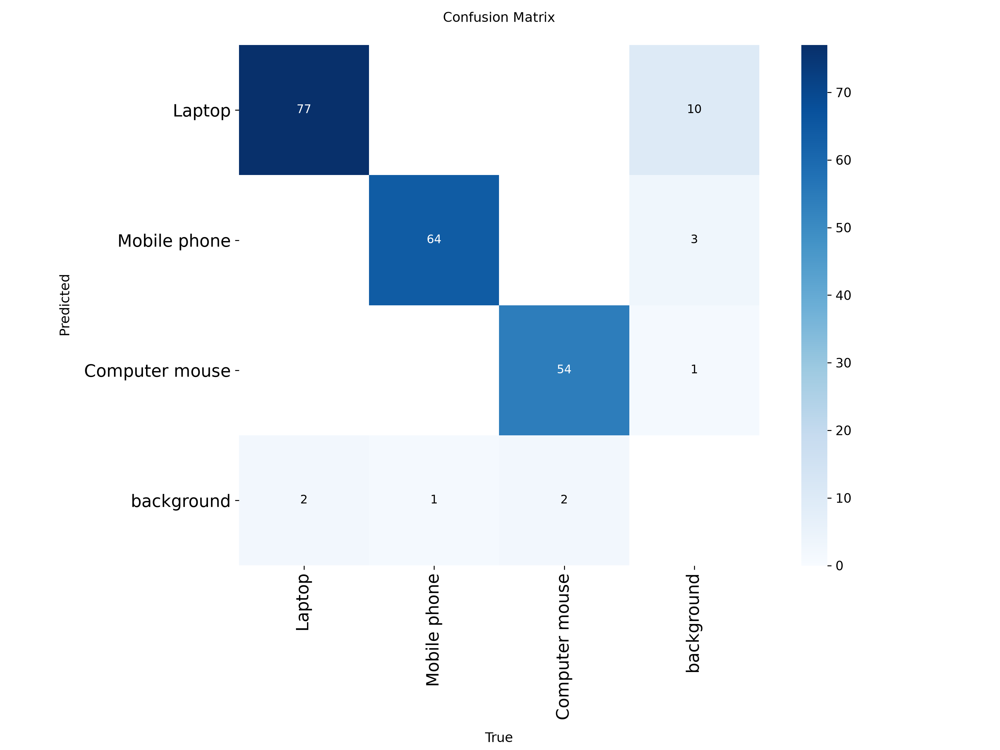

# desk-object-tracking-yolo

책상 위 물체(노트북 · 휴대폰 · 마우스)를 **YOLO11으로 감지하고 ByteTrack으로 추적**하는 프로젝트입니다.
Open Images V7의 공개 데이터만으로 COCO 사전학습 모델을 전이학습했고, 직접 찍은 영상에서 추적 결과를 확인했습니다.

## Demo

<!-- GitHub 웹 편집기에서 demo/mouse/tracking.mp4를 이 자리에 드래그 앤 드롭하면 영상 플레이어로 표시됩니다 -->

[▶ tracking.mp4 (5초)](demo/mouse/tracking.mp4) · [원본 demo.mp4](demo/mouse/demo.mp4)

박스 위의 `id:N`이 추적 ID입니다. 같은 물체는 프레임이 바뀌어도 같은 ID를 유지합니다.

## Overview

| 항목 | 내용 |
|---|---|
| 부류 | `Laptop`, `Mobile phone`, `Computer mouse` |
| 데이터 | [Open Images V7](https://storage.googleapis.com/openimages/web/index.html) (박스 라벨 포함, [FiftyOne](https://docs.voxel51.com/)으로 다운로드) |
| 모델 | YOLO11n (COCO 사전학습) → 전이학습 |
| 추적 | ByteTrack |
| 환경 | Windows 11, RTX 3050 Ti Laptop (4GB), Python 3.12, PyTorch 2.11 (CUDA 12.8), Ultralytics 8.4 |

## Dataset

부류마다 Open Images train에서 250장씩 무작위로 받고(seed 42), 중복 이미지를 제거한 뒤 3개 부류의 박스만 남겼습니다.
한 사진에 여러 부류가 함께 있는 경우가 있어 부류별 이미지 수가 250장보다 많습니다.

| 부류 | 이미지 | 박스 |
|---|---:|---:|
| Laptop | 332 | 480 |
| Mobile phone | 299 | 439 |
| Computer mouse | 299 | 335 |
| **합계** | **890** (train 742 / val 148) | 1,254 |

## Training

| 설정 | 값 |
|---|---|
| 모델 | `yolo11n.pt` |
| epochs / imgsz / batch | 50 / 640 / 16 |
| seed | 42 |
| 학습 시간 | 약 10분 (RTX 3050 Ti, AMP) |



train·val loss가 함께 꾸준히 내려가고 mAP는 50 epoch까지 계속 올라 과적합 징후는 없었습니다.

## Evaluation

val 148장 기준입니다. mAP50은 IoU 0.5 이상을 정답으로 볼 때의 AP(PR 곡선 아래 면적) 평균이고, mAP50-95는 IoU 기준을 0.5~0.95로 바꿔 가며 구한 AP의 평균입니다.

| 부류 | Precision | Recall | AP50 | AP50-95 |
|---|---:|---:|---:|---:|
| Laptop | 1.000 | 0.946 | 0.978 | 0.837 |
| Mobile phone | 0.992 | 0.985 | 0.993 | 0.857 |
| Computer mouse | 1.000 | 0.937 | 0.965 | 0.880 |
| **전체** | **0.997** | **0.956** | **0.979** | **0.858** |

| PR curve | Confusion matrix (conf 0.25) |
|---|---|
|  |  |

부류 사이의 혼동(예: 노트북 ↔ 휴대폰)은 없었습니다.

## Tracking

직접 찍은 영상(1920×1080, 60fps)에 추적 입력 크기 1280, conf 0.25로 ByteTrack을 적용했습니다.

| 부류 | 감지된 프레임 비율 | 추적 ID 수 |
|---|---:|---:|
| Laptop | 99.8% | 2 |
| Mobile phone | 53.9% | 8 |
| Computer mouse | 68.9% | 20 |

(17.8초 원본 영상 전체, 1,065프레임 기준)

- 노트북은 영상 내내 거의 하나의 ID로 추적됩니다.
- 마우스와 휴대폰은 **손으로 잡거나 가리면 ID가 새로 바뀝니다(ID switch).** ByteTrack이 사라진 물체를 기다리는 기본 시간이 30프레임(60fps에서 0.5초)이라, 그보다 오래 가려지면 새 물체로 판단합니다.
- 휴대폰은 **뒷면이 보이면 놓칩니다.** 학습 사진 대부분이 화면이 보이는 앞면이기 때문입니다.

## 시행착오: 물병 → 마우스

처음에는 세 번째 부류로 `Bottle`을 학습했습니다. 평가 점수는 높았지만 실제 영상에서는 물병을 전혀 찾지 못했습니다.

| | v1 `bottle` | v2 `mouse` |
|---|---|---|
| val mAP50 / mAP50-95 | 0.965 / 0.792 | 0.979 / 0.858 |
| 세 번째 부류 AP50 | Bottle 0.934 | Computer mouse 0.965 |
| 실제 영상 | 투명 생수병 **감지 실패** (conf 최대 0.16) | 감지 성공 |

**원인 분석**
- 같은 영상 프레임에서 원래 COCO 모델(yolo11n.pt)은 생수병을 conf 0.3~0.77로 찾았지만, 전이학습한 모델은 거의 0이었습니다.
- Open Images의 Bottle 학습 사진을 직접 확인해 보니 대부분 **라벨이 붙은 어두운 맥주병·와인병**이었고, 라벨 없는 투명 페트병은 거의 없었습니다.
- 다시 학습하면서 "병"의 개념이 학습 데이터 스타일로 좁아진 것입니다. **val 사진도 같은 Open Images 스타일이라 평가 점수에는 이 문제가 드러나지 않았습니다.**

**촬영 각도도 영향을 줬습니다.** 처음에 책상을 위에서 수직으로 찍었을 때는 휴대폰과 물병이 conf 0.01에서도 감지되지 않았습니다. 학습 사진처럼 앞에서 비스듬히 찍자 노트북과 휴대폰이 conf 0.8~0.9로 안정적으로 잡혔습니다.

v1 결과는 `weights/bottle/`, `results/bottle/`, `demo/bottle/`에 그대로 남겨 두었습니다.

## Project structure

```
src/
├── config.py      # 실험(부류) 선택, 경로, 공용 설정
├── data.py        # Open Images 다운로드 → YOLO 포맷 변환
├── train.py       # 전이학습
├── evaluate.py    # mAP 평가, 그래프 저장
├── track.py       # 영상 감지 + 추적, H.264 mp4 저장
└── utility.py     # 로그 출력
weights/<exp>/best.pt    # 학습된 모델
results/<exp>/           # 학습 곡선, PR 곡선, confusion matrix
demo/<exp>/              # demo.mp4(입력), tracking.mp4(추적 결과)
```

`<exp>`는 실험 이름(`mouse`, `bottle`)입니다.

## Usage

```bash
python -m venv .venv
.venv\Scripts\activate
pip install -r requirements.txt
```

`requirements.txt`는 PyTorch CUDA 12.8 빌드를 사용합니다(`--extra-index-url` 포함).

```bash
python src/data.py       # 데이터 다운로드 (data/)
python src/train.py      # 학습 → weights/<exp>/best.pt
python src/evaluate.py   # 평가 → results/<exp>/
python src/track.py      # 추적 → demo/<exp>/tracking.mp4
```

- 기본 실험은 `mouse`입니다. 다른 실험은 환경변수로 선택합니다. 예: `EXPERIMENT=bottle python src/evaluate.py`
- 추적할 영상은 `demo/raw/`에 넣고 `src/config.py`의 `SOURCE_VIDEOS`에 파일 이름을 지정합니다.
